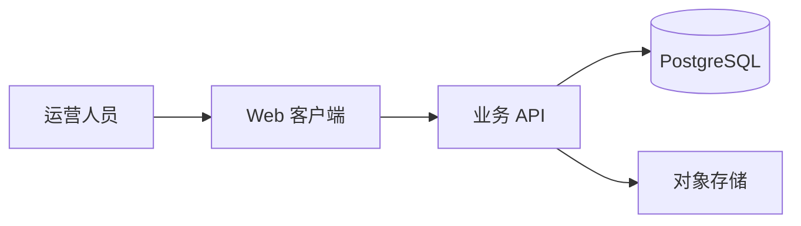

# 版本管理规范

## 硬约束

> 本节是 AI 必守清单，违反即错误；下文各节是背景、模板和细节，按需阅读。

- **MUST**：代码变更同步记录变更说明；并行开发优先使用每任务独立的变更片段，发布阶段统一更新版本号、归并 `CHANGELOG.md` 及版本文档，不要求每个开发提交争改同一版本文件
- **MUST**：默认版本号格式 `MAJOR.MINOR.BUILD`（如 `1.2.1`、`0.28.31`）；公共库或明确采用标准 SemVer 的项目按下文例外执行
- **MUST**：BUILD 是单调递增整数，从 1 开始；同一发布单元的权威分配器按上次已分配值 +1 原子预留，永不重置、不补前导零；失败预留可留空号，不回收给其它候选
- **MUST**：功能新增提升 MINOR 或 MAJOR；bugfix 只递增 BUILD，不提升前两段；同一发布单元由一个发布责任方统一分配版本
- **MUST**：同一发布单元内前后端、API header（如 `X-App-Version`）和产物版本一致；可独立升级 / 回滚的单元可独立版本，根记录负责汇总
- **MUST**：普通提交、推送、合并与正式发布区分；仅在用户明确要求发布或既有发布策略授权时创建并推送发布 tag，不把“提交代码”扩大为发布授权；单一单元可用 `v{版本号}`，同仓库独立版本单元须使用唯一命名空间，如 `{发布单元}/v{版本号}`
- **MUST**：发布 tag 只能指向已合入默认分支且通过必需检查的确定提交；CI 校验 tag 所属发布单元及其与发布清单、产物和发布说明的版本一致，产品 / 架构文档引用唯一发布入口，若内嵌版本号也须一致
- **MUST**：持久记录发布 ID、版本、来源 SHA 与产物摘要的映射；同一候选重试复用映射，来源或产物变化则新建候选，不得移动已发布 tag 或覆盖同版本产物
- **MUST**：业务代码仓库在新项目时创建根目录 `.gitignore` 和 `ARCHITECTURE.md`；架构变更在同一改动中更新文档
- **例外：规则库仓库（meta）**：仅维护 Markdown 规则、生成器与校验脚本的仓库（如 `niuwoai/agentrules`）**不**强制套用「业务四文档」门禁——不要求因缺失 `PRODUCT_OVERVIEW.md` / `ARCHITECTURE.md` 而阻断开发；本仓库若保留二者仅为发布/CI 自检与入口索引，**不得**在其它仓库中推断「规则库也必须补齐产品概览与架构主文档」。规则库发版以 `README.md`、`CHANGELOG.md`、主题规则与 `rake test` 为准；无应用 Schema 时 **MUST NOT** 为规则库凭空编造数据库 migration
- **MUST**：敏感文件（`.env`、密钥等）必须列入 `.gitignore`，不得提交
- **MUST NOT**：直接在 main/develop 上 commit；一律走 feature 分支 + PR
- **MUST NOT**：一个 PR 混入彼此无关的目标；为同一目标必需的修复、重构和测试可一起交付，保持可独立验证和回退
- **MUST NOT**：改了版本号不写 CHANGELOG，或 CHANGELOG 与代码不同步
- **MUST**：`PRODUCT_OVERVIEW.md` 与 `ARCHITECTURE.md` 主文档 ≤ 1,000 字符（约 1k tokens），写不下则拆到 `docs/product/`、`docs/architecture/` 等子文档并在主文档保留入口表；`README.md`、`CHANGELOG.md` 等按 `ai-guardrails.md` 通用入口预算维护；`CHANGELOG.md` 只保留最近版本、历史归档到 `docs/changelog/`
- **MUST**：产品 / 架构主文档顶部保留当前版本入口；源码记录版本时使用 `当前版本：vMAJOR.MINOR.BUILD`，CI 注入模式可链接唯一发布索引，由项目 CI 解析核验；本规则库仍用三处显式版本一致校验

## 分支策略

### 默认主干流程

- **短分支 + PR + 受保护主干**：从仓库约定的目标分支创建小分支，快速验证、审查并合入；主干保持可发布，不直接在 main / develop 上提交。
- **保留已有流程**：已经使用 develop / release 分支的项目遵守其约定；仅仅存在 develop 分支不代表必须多绕一次合并。
- **并行隔离**：多个写入会话使用独立工作区，指定共享文件的协调者；任务与交接协议见 [delivery.md](delivery.md)。

### 开发与发布分开

1. 从最新目标分支创建任务分支，在独立 worktree / checkout 开发。
2. 提交本任务文件及独立变更片段；不提前抢占正式版本号。
3. PR 审查具体 head；在合并队列或等价机制中验证与当前目标分支的集成结果。
4. 发布责任方从已合入且满足门禁的代码准备候选，统一版本与 CHANGELOG；若版本文件需要提交，通过发布 PR 合入，不能绕过分支保护。
5. 对最终确定 SHA 及其产物验证，已有授权允许时打本次 tag 并分发；部署和渠道晋级另遵守 [deployment.md](deployment.md)。

集成候选、审查 SHA 或依赖发生变化时，重新确认受影响证据；不能拿旧 base 的绿色结果直接放行新集成结果。

### 分支命名
```
feature/<功能名>      # feature/user-auth, feature/payment
fix/<问题描述>        # fix/login-timeout, fix/typo
release/<版本号>      # release/v1.2.7
hotfix/<问题描述>     # hotfix/critical-bug
```

## 版本号

格式：`MAJOR.MINOR.BUILD`（如 `1.4.12`、`2.0.13`、`0.28.31`）。前两段表示大版本 / 小版本；第三段 `BUILD` 为发布候选的分配序号，从 `1` 起按权威高水位 +1 预留，永不重置（MAJOR/MINOR 升级后仍继续递增）。成功版本之间允许因失败预留出现空号。

### 默认约定（业务项目 / 内部项目）

| 变更类型 | MAJOR | MINOR | BUILD |
|---------|-------|-------|-------|
| bugfix | 不变 | 不变 | +1 |
| 新增功能（向后兼容） | 不变 | +1 | +1 |
| 破坏性变更 | +1 | 归零 | +1 |

**BUILD 规则：**
- 从 `1` 开始，每次新候选按该发布单元上次已分配值 +1 预留；同候选重试不再加号。
- 分配需由权威发布服务、原子计数器或持久账本在单元级互斥下完成，禁止多个 worker 各自在本地读取“最新 tag +1”。CI run 序号只有在其作用域、持久性及重跑语义满足该约定时才能直接使用。
- 分配后立即持久记录发布 ID、版本和输入 SHA；版本准备完成后记录最终候选 SHA 并冻结，再开始构建和验证。使用发布 PR 时，输入 SHA 与最终候选 SHA 不同，必须分别记录，不能把准备前的检查当作最终结果。打包完成追加产物摘要。
- 冻结前准备失败可安全重试同一预留；冻结后源码或构建输入改变必须新建候选并分配新版本。失败可以留下空号，禁止将空号重新分配给另一候选，也不能用失败产物覆盖成功版本。
- 永不重置；例：`0.1.1` → `0.1.2`（修 bug）→ `0.2.3`（新功能）。版本分配顺序不证明来源提交的先后，较大 BUILD 不能授权旧源码晋级；最终切换按 [部署规则](deployment.md) 校验来源推进关系。
- 第三段按整数书写，**不要**写成 `00031` 等形式；单一发布单元的 tag 示例为 `v0.28.31`、`v1.2.7`。

### 发布标签命名空间

发布契约记录 tag 格式。单一发布单元可用 `v{版本号}`；同仓库独立版本单元使用 `{发布单元}/v{版本号}` 等唯一格式，例如 `api/v1.0.1` 与 `web/v1.0.1` 可以指向不同候选。CI 按契约解析单元及版本，再校验对应 SHA、产物和发布说明；不能复用其它单元的 tag 或移动已发布 tag。本规则库为单一发布单元，继续使用 `v{版本号}`。

### 已废弃：`0.00.000-rc{xx}` 与 `-rcN`

- **MUST NOT**：新规则库或业务项目再采用 `0.00.000-rc12`、`-rcN` 预发布后缀，或「正式版本 + 独立 rc 号重置」那一套（见本仓库 CHANGELOG 0.26.0 / 0.22.0 之前说明）。
- **MUST**：一律改用本节 `MAJOR.MINOR.BUILD`；第三段即发布序号，不再单独维护 rc。
- **迁移**：旧 tag/文档若仍为 `vX.Y.Z-rcN`、`vX.Y.Z` 或曾用五位 BUILD（如 `v0.28.00031`），下次发版改为裸整数 BUILD（如 `v0.28.32`）；BUILD 序号与旧 tag 末段数值连续，不得用前导零。

### 例外：标准 SemVer 项目

对外发布的开源库、公共 npm/Go module/PyPI 包，或团队已明确采用标准 SemVer 的项目，按标准语义处理：

| 变更类型 | 版本号 | 说明 |
|---------|--------|------|
| PATCH | 1.4.X → 1.4.X+1 | bug 修复，行为不变 |
| MINOR | 1.X → 1.X+1.0 | 新增功能，向后兼容 |
| MAJOR | X → X+1.0.0 | 破坏性变更，不兼容旧 API |

哪套都行，但一个项目只能用一套；项目现状与本规范不一致时，在 `AGENTS.md` / `CLAUDE.md` 里写明采用哪套。

### 版本号在哪改
- 完整版本字符串一处为真：`"1.2.7"`（Go `Version` / 前端 `version` / Python `__version__`）
- 多项目仓库：各子项目独立版本号，根目录 CHANGELOG 汇总

### 每次改动前先想
- 这是修 bug？→ 只递增 BUILD（标准 SemVer 项目递增 PATCH）
- 加了新功能但 API 没变？→ MINOR +1，BUILD +1
- 删了接口 / 改了字段类型 / 行为不兼容？→ MAJOR +1、MINOR 归零，BUILD +1

### 版本准备与重试

- 开发分支写唯一命名的变更片段，如 `changes/<任务ID>.md`，包含发布单元、Added / Fixed 等类型、兼容影响与简要说明；不强制使用某个 changeset 工具。
- 发布责任方根据候选相对上次发布的变更级别计算下一版本，汇总候选中的变更片段形成不可变发布说明。账本记录已覆盖哪些片段；旧文件尚未清理不代表需要再次升 MINOR。失败不能丢掉尚未成功交付的说明。
- **高频项目推荐 CI 注入**：从已验证的主干 SHA 预留版本，构建前冻结发布清单并注入版本，产品 / 架构入口链接唯一发布索引。版本与说明不必为每次发布增加人工提交。若自动回填仓库 CHANGELOG，使用受保护 PR，排除纯回填引发业务发版的递归触发。
- **源码必须含版本时**：自动化以普通发布 PR 同步版本、CHANGELOG 和内嵌版本的主文档，再对最终合入提交重新验证；不要求开发者逐次手动准备发布 PR。版本变化也是构建输入，不能复用旧产物的验证结果。
- 两种模式都须确保 tag、产物、发布记录和 API 展示可追溯且一致；不得每个环境重新注入新版本 / 重建同名包。准备完成后的最终候选 SHA 一经冻结不可变化。
- 幂等键至少含发布单元与发布 ID。网络超时先查询远端是否已成功；同版本产物已存在时校验 SHA 和摘要，一致则复用，不一致则失败，不使用覆盖上传“修好”版本。
- 版本分配锁只保护预留与持久映射，不覆盖全部构建、测试和签名步骤；独立候选可并行打包。
- 若平台把「市场版本」与「构建号」拆成两个字段：前两段写入短版本（如 `1.2` 或 `1.2.0`），第三段 BUILD 写入构建号字段。

### macOS/iOS 项目

- `CFBundleShortVersionString`：前两段（或团队约定的短版本）
- `CFBundleVersion` / `CURRENT_PROJECT_VERSION`：与本规范 BUILD 对齐，每次发版 +1，从 1 递增不重置
- 在哪改：`Info.plist` / `.xcconfig` / Xcode `CURRENT_PROJECT_VERSION`

## CHANGELOG.md

每次代码变更同步增加可归并的说明；发布阶段统一生成正式版本段落，按时间倒序排列。单人低频项目可直接维护 `Unreleased`；并行项目优先使用唯一命名的变更片段，避免多个分支争改文件顶部。只有发布责任方归并片段、更新正式版本和归档。

### 格式模板
```markdown
# Changelog

## [1.2.7] - 2026-05-27

### Added
- 用户注册接口 /api/auth/register
- 登录失败 5 次锁定 15 分钟

### Changed
- 密码哈希从 md5 改为 bcrypt

### Fixed
- 修复 token 过期后不自动刷新的问题

### Deprecated
- /api/v1/login 将于 v2.0 移除，请迁移到 /api/v2/auth

---

## [1.1.3] - 2026-05-20

### Added
- 仪表盘页面
```

### 分类标准
- **Added**：新增功能
- **Changed**：修改已有功能
- **Fixed**：Bug 修复
- **Removed**：删除功能
- **Deprecated**：即将删除，先标废弃
- **Security**：安全修复

### 规则
- 一个版本一个 `## [版本号]` 段落
- 没有对应内容的分段直接省略（别写 "None"）
- 每条用一句话说清改了什么，附上 PR 号更好

### 体量与分卷

- 主文件只保留最近 3 个版本或最近 90 天；更早的段落归档出去。
- 超过 300 行或 20,000 字符必须归档：把整段 `## [版本号]` 移到 `docs/changelog/v{MAJOR}.{MINOR}.md`，主文件末尾保留「历史归档」索引（链接 + 覆盖的版本范围）。
- 当前版本段落必须在主文件最上方；脚本取主文件第一个 `## [版本号]` 作为当前版本。
- 归档只搬不改：版本号、日期和条目措辞在搬运中不得变化。

## PRODUCT_OVERVIEW.md

**这是项目的"当前状态说明书"**——不看代码也能知道项目是什么、有什么功能、怎么跑。

### 它回答什么，不回答什么

| 问题 | `PRODUCT_OVERVIEW.md` 的答案 |
|------|-------------------------------|
| 这是什么项目、给谁用、解决什么问题？ | 必须回答 |
| 现在能做什么、首版不做什么、有哪些已知限制？ | 必须回答 |
| 如何本地运行、部署和验证？ | 必须回答 |
| 每个模块内部怎么实现、表字段和函数如何调用？ | 不写，转到 `ARCHITECTURE.md`、API 文档或代码 |

把它当作产品交接页：新成员和 AI 先读它，应该能在几分钟内理解项目边界与当前状态。

### 格式模板
```markdown
# Product Overview

> 最后更新：2026-05-27 | 当前版本：v1.2.7

## 项目简介
一句话说清楚这个项目是干什么的。

## 核心功能
- 用户注册/登录（支持手机号 + 邮箱）
- 仪表盘数据概览
- 工单创建与流转
- ...

## 当前范围
- 本版本目标：让运营人员在一个工作台查看并处理工单。
- 暂不支持：移动端、第三方工单系统双向同步。

## 技术栈
- 后端：Go 1.23 + chi + sqlx + MySQL 8.0
- 前端：React 19 + TypeScript + Vite + Tailwind CSS
- 部署：Go embed 单文件，systemd 守护

## API 概览
| 方法 | 路径 | 说明 |
|------|------|------|
| POST | /api/auth/login | 用户登录 |
| GET | /api/users/me | 当前用户信息 |
| ... | ... | ... |

## 部署
- 编译：`make build`
- 运行：`./bin/server`
- 配置：环境变量 `APP_PORT` `DB_DSN`

## 文档入口
- 架构与技术决策：[ARCHITECTURE.md](ARCHITECTURE.md)
- API 契约：`docs/api.md`
- 部署手册：`docs/runbook.md`

## 已知问题 / 待办
- [ ] 密码重置流程未实现
- [ ] 大屏适配（移动端）
```

### 规则
- 源码记录版本的项目由发布阶段更新内嵌版本号和日期；CI 注入模式保持唯一发布入口可用，行为正文仍随对应改动更新。
- 新增、删除或改变用户可见行为的功能时，同步更新“核心功能”“当前范围”“API 概览”和已知限制。
- 项目定位、目标用户、主要流程、运行方式或交付入口发生变化时，同步更新。
- 只重构内部代码且不改变产品能力、运行方式或已知限制时，通常不必更新；不要把实现日志塞进来。
- **这份文档给新人看的**——他应该能靠这个文档把项目跑起来

### 体量预算与索引式结构

`PRODUCT_OVERVIEW.md` 受 ≤ 1,000 字符（约 1k tokens）约束；其他通用入口文档受 `ai-guardrails.md` 预算（≤ 300 行 且 ≤ 20,000 字符）。超预算时按下面顺序下沉：

1. 先搬 API 概览与完整功能清单。
2. 再搬运行与部署细节。
3. 最后搬历史范围变更。

下沉后主文档保留定位、范围、核心能力摘要、`当前版本：vMAJOR.MINOR.BUILD` 和入口表。入口表模板：

```markdown
## 文档入口
| 子文档 | 内容 | 什么时候读 |
|--------|------|-----------|
| [docs/product/features.md](docs/product/features.md) | 逐模块功能清单与当前状态 | 需要确认某功能是否已实现时 |
| [docs/product/api-overview.md](docs/product/api-overview.md) | 完整接口清单与字段 | 改接口或对外对接时 |
```

## ARCHITECTURE.md

**这是项目的“技术地图”**——让后来者能快速理解系统如何组成、数据如何流动，以及为何采用当前方案。

### 它回答什么，不回答什么

| 问题 | `ARCHITECTURE.md` 的答案 |
|------|---------------------------|
| 系统由哪些客户端、服务、数据库和外部系统组成？ | 必须回答 |
| 模块边界、依赖方向、请求/事件/数据如何流动？ | 必须回答 |
| 为什么选该技术、存储、通信或部署方案？ | 必须回答重要取舍 |
| 某个函数、组件或全部接口字段怎么写？ | 不写，转到代码、模块 README、OpenAPI 或 ADR |

把它当作技术交接页：读完后应能画出系统、判断改动会影响哪里，并知道关键方案不是“祖传玄学”。

### 规则
- **新项目必须创建**：开始正式实现前，项目根目录必须创建 `ARCHITECTURE.md`；已有仓库缺失时，应在首次涉及架构或模块改动前补齐。
- **架构变更必须同步更新**：技术栈、系统边界、模块拆分或合并、服务通信、数据存储、接口协议、认证授权、异步任务、部署拓扑、关键第三方集成等发生变化时，必须在同一改动中更新文档。
- **文档必须可追溯**：文件顶部记录最后更新日期及内嵌版本或唯一发布入口；重要取舍链接 ADR 或说明背景、决策和影响。
- **不要把普通实现细节都塞进去**：`ARCHITECTURE.md` 记录稳定的系统级设计；局部实现细节留在模块 README、代码注释或 ADR，避免文档长成技术墓志铭。
- **入口文档预算**：`ARCHITECTURE.md` 主文档 ≤ 1,000 字符（约 1k tokens）——系统上下文图、模块职责表、关键决策摘要可保留精简版；接口完整字段、逐模块实现细节和 ADR 全文下沉到 `docs/architecture/`。

### 推荐模板
````markdown
# Architecture

> 最后更新：2026-05-27 | 当前版本：v1.2.7

## 架构概览
一句话说明系统形态与主要边界，例如“React Web 客户端通过 REST API 调用 Go 单体服务，服务使用 PostgreSQL 持久化数据，并接入对象存储处理附件”。

## 系统上下文
用 Mermaid 或文本图画出用户、客户端、服务、数据库、队列和第三方依赖；箭头标明 HTTP、事件或文件流。



## 模块与职责
| 模块 | 职责 | 依赖 / 通信方式 |
|------|------|-----------------|
| Web 客户端 | 展示工作台、提交操作 | HTTPS 调用业务 API |
| 业务 API | 认证、工单流程、审计 | SQL、对象存储 SDK |

## 数据与接口
- 关键数据：哪些数据存在哪里，哪些是敏感数据，谁可以访问。
- 关键流程：以“创建工单 → 处理 → 通知”为例，写清数据和事件流向。
- 契约：接口风格、事件主题、鉴权方式；完整字段定义链接到 OpenAPI 或专门 API 文档。

## 部署与运行
- 运行单元：进程、容器、服务或任务队列分别部署在哪里。
- 发布与配置：构建产物、环境变量、迁移执行顺序和回滚入口。
- 可靠性：健康检查、日志/指标、备份恢复、扩缩容或降级策略。

## 关键决策与演进
| 决策 | 原因 | 影响 / ADR |
|------|------|------------|
| 先采用模块化单体 | 团队小且业务仍在验证 | 服务边界稳定后再拆分；ADR-001 |

## 已知限制
- 当前文件上传由同步请求处理；超过 100 MB 时改为异步任务。
````

### 两份文档何时一起更新

| 变更 | Product Overview | Architecture |
|------|------------------|--------------|
| 新增用户可见功能或改变产品范围 | 必须更新 | 仅当影响系统设计时更新 |
| 更换数据库、框架、认证方式或部署拓扑 | 如运行方式/技术栈描述变化则更新 | 必须更新 |
| 新增服务、队列、第三方关键集成或跨服务事件 | 可选 | 必须更新 |
| 新增或修改一个 API 的字段 | 如公开 API 概览变化则更新 | 仅影响契约风格、边界或关键数据流时更新 |
| 单模块内部重构、改函数名、修 CSS | 通常不更新 | 通常不更新 |

## 提交流程

### 每次开发结束的标准动作

1. 检查工作区和 diff，确认只包含本任务文件；补充变更片段与必要的产品 / 行为参考。
2. 运行受影响检查，记录 base / head、命令、实际结果和未验证项。
3. 暂存明确文件路径，检查 staged diff 后提交；普通提交不打 tag。
4. 在推送 / PR 已有授权范围内推进，由集成责任方完成当前目标分支的验证与合并。
5. 发布责任方另行执行版本准备和发布门禁。没有发布授权时停在交接，不自动对外分发。

示例中的文件路径按实际变更替换，不能用 `git add .` 一揽子带入其它任务：

```bash
git add src/auth.go changes/task-123.md
```

```bash
git diff --cached
```

```bash
git commit -m "feat(auth): add user registration"
```

发布阶段确认最终 SHA、版本和全部必需检查后，仅推本次 tag；以下占位值须由发布流程替换：

```bash
git tag -a v1.3.9 <verified-release-sha> -m "Release v1.3.9"
```

```bash
git push origin refs/tags/v1.3.9
```

### Commit Message 规范
```
type(scope): summary

详细说明（可选，可多行）
```

| type | 用途 |
|------|------|
| feat | 新功能 |
| fix | Bug 修复 |
| docs | 文档变更 |
| style | 格式（不影响代码逻辑） |
| refactor | 重构 |
| perf | 性能优化 |
| test | 测试 |
| chore | 构建/工具/版本号 |
| ci | CI/CD 变更 |

### 别做的事
- 别直接在 main/develop 上 commit
- 别在一个 PR 夹带无关目标；同目标必需的修复、重构和测试一起验证
- 别把普通提交当成发布，不得批量 `git push --tags` 推出无关候选
- 别改完版本号不写 changelog；并行任务先写变更片段，由发布阶段收口
- 别让 CHANGELOG 和代码不同步
- 别把入口文档写成百科全书
- 别把已经下沉的细节再复制回主文档

## .gitignore

每个项目根目录必须有 `.gitignore`。以下是在各种项目中常见的忽略条目：

### 通用
```
.DS_Store
*.swp
*.swo
*~
.env
.env.local
*.log
.cache
```

### Node / 前端
```
node_modules/
dist/
build/
.next/
.nuxt/
.cache/
```

### Go
```
.local-cache/
vendor/（除非使用 vendor 模式）
```

### Python
```
__pycache__/
*.pyc
.venv/
venv/
.pytest_cache/
.mypy_cache/
.ruff_cache/
```

### macOS / iOS
```
DerivedData/
*.xcworkspace/xcuserdata/
Pods/
.build/
```

### 规则
- **能匹配目录的用 `/` 结尾**（如 `node_modules/`），避免误伤同名文件
- **优先用 `*` 模式**，别逐条写几百行
- **敏感文件必须列在 `.gitignore`**（`.env`、密钥文件等）
- **别临时 `git add -f` 忽略的文件**——除非真的有理由打破规则

## 完整 workflow 示例

```
想做一个用户头像上传功能：

1. 从最新的约定目标分支创建 feature/avatar-upload 和独立工作区
2. 明确对象存储、上传接口、文件安全和兼容边界，开发并验证
3. 添加 changes/task-avatar.md，描述 Added、影响的发布单元与验收结果
4. 有产品 / 架构行为变化时更新对应参考，不预先争改正式版本
5. 只提交本任务文件，推送并提 PR；审查绑定明确 head
6. 合并队列验证当前目标分支 + 本次改动，再合入
7. 发布责任方预留 v1.3.9，汇总已合入片段并同步版本文档
8. 版本准备通过发布 PR 合入后，冻结最终候选 SHA
9. 同候选必需检查和具体产物验证成功后，按已有授权推本次 tag
10. 分发不可变产物；同环境 / 渠道通过顺序保护晋级并验证
11. 记录已分发或已部署的实际结果、恢复入口和仍未完成的阶段
```
